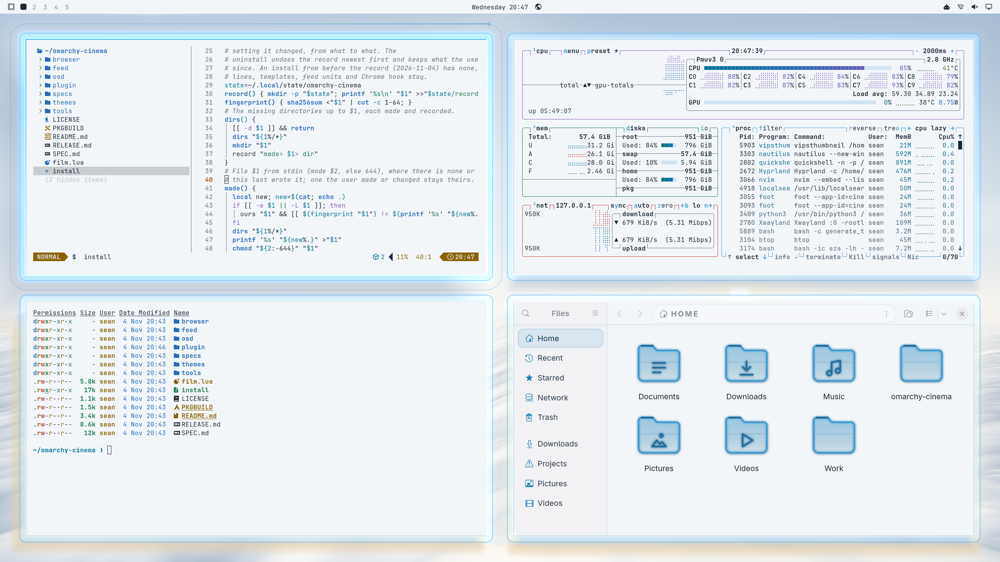

# Oblivion

Tower 49 at dawn. A high pale sky over a sea of cloud that slides slowly toward the tower, the sun low on the horizon and the broken moon faint in the daylight. Every window is a pane of the tower's glass, traced by a fine blue line and lit along the edges that face the sun; round the focused one a drone's sensor ring circles. The panes float in the sun's light.  The theme is light, so the backdrop paints, not glows: lines are ink mixed over the sky, and light is a lift toward white. Under the windows only a near white wash of the sky's light shows, so the frosted glass reads as white paper with dark text on it.

An [Omarchy](https://omarchy.org) theme from [Omarchy Cinema](https://github.com/seankd3/omarchy-cinema). On its
own it is a whole Omarchy theme with its film as the wallpaper. With the
Omarchy Cinema engine installed, the film comes alive: it is drawn around your
windows in the same frame as them, windows turn to glass with their text kept
solid, and Files, its folders and the dictation popup take its look.

    omarchy theme install https://github.com/seankd3/omarchy-oblivion-theme

[Try it in the browser](https://seankd3.github.io/omarchy-cinema/play/?film=https://raw.githubusercontent.com/seankd3/omarchy-oblivion-theme/HEAD/) before you install it.

## Make your own

Press *Use this template* to start a film from this one. Change
`colors.toml`, write `backdrop.frag` against [the contract](https://seankd3.github.io/omarchy-cinema/play/contract.html),
watch it in the [playground](https://seankd3.github.io/omarchy-cinema/play/),
name your repo `omarchy-<name>-theme`, and give it the topic
`omarchy-cinema` to list it in the gallery.

This repo is built from `themes/oblivion` of [omarchy-cinema](https://github.com/seankd3/omarchy-cinema) by
`tools/theme-repo`; changes go there.

## Credits

A fan homage. The film and its marks belong to their owners; this theme is
not affiliated with or endorsed by them, and ships no film imagery: the
wallpaper is this theme's own `backdrop.frag`, drawn. MIT licence (LICENSE).
